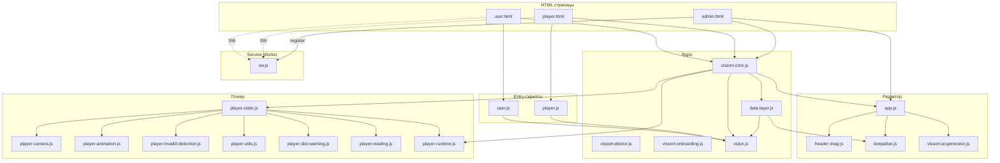
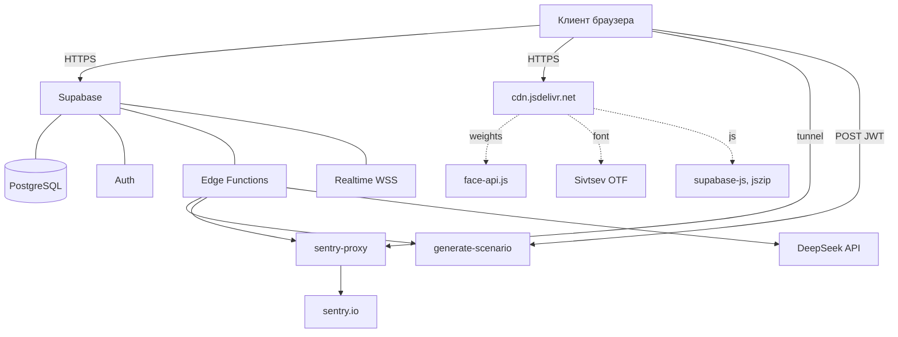

# Vissort — диаграммы архитектуры

> Mermaid-диаграммы архитектуры Vissort.
> Дополнение к PROJECT-MAP.md (ASCII-графы в §2).
> Рендерится в GitHub, VSCode, Obsidian.

Связанные документы: PROJECT-MAP.md, PLAN.md, DEPLOY.md.

## Содержание

- §2.1 Общий граф загрузки
- §2.2 Граф плеера
- §2.3 Граф редактора
- §2.4 Внешние сервисы

---
## §2.1 Общий граф загрузки



---

## §2.2 Граф плеера

```mermaid
graph LR
    HTML[player.html / user.html] --> Core[vissort-core.js]
    HTML --> PS[player-state.js]

    PS --> PC[player-camera.js]
    PS --> PA[player-animation.js]
    PS --> PI[player-invalid-detection.js]
    PS --> PU[player-utils.js]
    PS --> PD[player-dist-warning.js]
    PS --> PR[player-reading.js]

    PC -.callbacks.-> RT[player-runtime.js]
    PA -.onSetStimColor.-> RT
    PI -.callbacks.-> RT

    RT --> DL[data-layer.js]
    RT --> VO[voice.js]
    RT --> O[vissort-onboarding.js]
    RT --> V[vissort-device.js]

    PC -.window._recordDeviation.-> PI
    PC -.window._updateStimulusDim.-> PI
    PD -.DOM.-> RT
    VO -.DOM.-> RT
```

---

## §2.3 Граф редактора

```mermaid

graph LR
    HTML[admin.html] --> Core[vissort-core.js]
    HTML --> DL[data-layer.js]
    HTML --> VO[voice.js]
    HTML --> KA[keepalive.js]

    DL --> APP[app.js]
    VO --> APP
    KA --> APP

    APP --> HD[header-drag.js]
    APP -.window.AppEditorCore.-> AI[vissort-ai-generator.js]

    DL -.Data.saveScenario.-> APP
    DL -.Data.getScenarios.-> APP
    DL -.Data.saveTemplate.-> APP

    AI -.fetch.-> Edge[Edge Function: generate-scenario]
    Edge -.DeepSeek.-> AI

    KA -.GET.-> SB[Supabase training_sessions]
```

---

## §2.4 Внешние сервисы



---

Составлено: 2026-10-11.
Источник: PROJECT-MAP.md §2 + визуализация в mermaid.
Диаграмм: 4.
